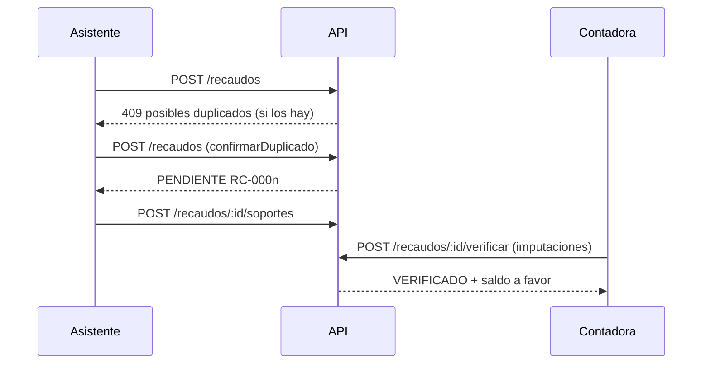

# Diseño: REQ-003 Recaudos

## Tablas nuevas (todas con `condominio_id` + RLS `app_condominio_id()`)

| Tabla                  | Contenido                                                   | Grants `zulu_app`      |
| ---------------------- | ----------------------------------------------------------- | ---------------------- |
| `recaudo`              | Pago: número consecutivo, datos, estado, verificación       | SELECT, INSERT, UPDATE |
| `imputacion_recaudo`   | Concepto, periodo, valor de la obligación y valor aplicado  | SELECT, INSERT         |
| `soporte_recaudo`      | Comprobante (bytea), tipo, tamaño, SHA-256                  | SELECT, INSERT         |
| `importacion_recaudos` | Borrador de importación: filas revisadas (JSON) y su estado | SELECT, INSERT, UPDATE |

Sin DELETE en ninguna. Dinero `DECIMAL(18,2)` con `CHECK (valor > 0)`. FKs compuestas `(condominio_id, unidad_id)` y `(condominio_id, propietario_id)` para que un pago no pueda apuntar a otra copropiedad.

## Decisiones

- **Número consecutivo** por condominio (`RC-0001`): `max(numero)+1` bajo `pg_advisory_xact_lock` por condominio, con `UNIQUE (condominio_id, numero)` como respaldo.
- **Imputaciones inmutables**: se crean una sola vez al verificar. Corregir un pago verificado = anularlo y registrar otro (RN-02). Un pago anulado conserva sus imputaciones, pero deja de contar.
- **Saldo a favor** = valor − suma aplicada, calculado y guardado al verificar; no hay tabla aparte, así no se puede duplicar.
- **Duplicados**: advertencia, no bloqueo. 409 con la lista de similares; se reintenta con `confirmarDuplicado: true` y queda marcado `posible_duplicado`.
- **Soportes en la base** (bytea), igual que los documentos de propietarios. Se valida la firma del archivo, no solo el tipo declarado.
- **Importación en dos pasos**: previsualizar guarda un borrador con cada fila clasificada (válida, advertencia, duplicado, error); confirmar revalida duplicados y crea los pagos como PENDIENTE.
- **Reglas puras** (parseo de valores y fechas, cálculo de imputación) en `recaudos.reglas.ts` con pruebas unitarias.

## Permisos (área 02)

| Operación                                          | Acción     |
| -------------------------------------------------- | ---------- |
| Listar, detalle, descargar soporte                 | `leer`     |
| Registrar, adjuntar soporte, importar              | `crear`    |
| Modificar pago pendiente/observado, asignar unidad | `editar`   |
| Verificar, observar, anular                        | `aprobar`  |
| Exportar                                           | `exportar` |

## Eventos de auditoría (`objeto_tipo = recaudo`)

`recaudo.registrado`, `recaudo.modificado`, `recaudo.identificado`, `recaudo.soporte_cargado`, `recaudo.soporte_consultado`, `recaudo.verificado`, `recaudo.observado`, `recaudo.anulado`, `recaudos.importacion_confirmada`, `recaudos.importacion_descartada`, `recaudos.exportados`.

## Flujo

