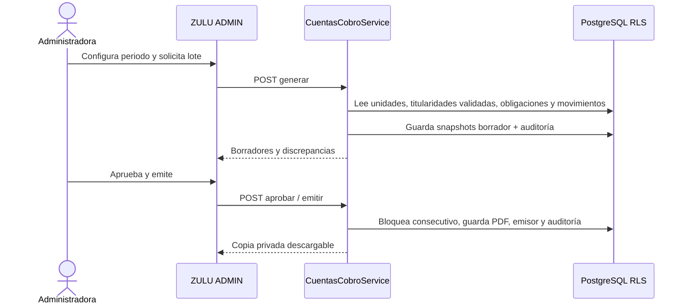

# Diseño REQ-005

## Arquitectura

Módulo Nest `cuentas-cobro`, Prisma y PostgreSQL; React usa API autenticada existente. Toda lectura/escritura usa `withTenant`, RLS, permisos del área 02 y auditoría append-only. El borrador copia titularidad, unidad, conceptos, movimientos y saldos conciliados al corte. Emisión asigna consecutivo bajo advisory lock y conserva bytes PDF privados en la BD. Los estados y PDF emitido no se editan; correcciones se hacen anulando con motivo y generando otra versión/cuenta.

La cartera se calcula únicamente desde obligaciones y movimientos registrados; pagos no verificados se excluyen. No se crean obligaciones desde facturación. Cada unidad puede tener una única cuenta activa por periodo; cuentas anuladas conservan su consecutivo y permiten una nueva revisión con relación al original.

## Secuencia

## Datos y permisos

Tablas `periodo_cobro`, `concepto_cobro`, `cuenta_cobro`, `envio_cuenta_cobro`: todas llevan `condominio_id`, RLS y grants explícitos. La cuenta conserva JSON de detalle y PDF bytes inmutable. Permisos área 02: lectura, edición para configurar/generar, aprobación para aprobar/emitir/anular, exportación para exportar. Auditoría: periodo/concepto creados, cuenta generada, aprobada, emitida, enviada y anulada.

El correo real queda detrás de la configuración de transporte disponible; el registro de envío conserva canal, estado, destinatario, usuario, fecha y respuesta técnica no sensible. No hay enlaces públicos.
