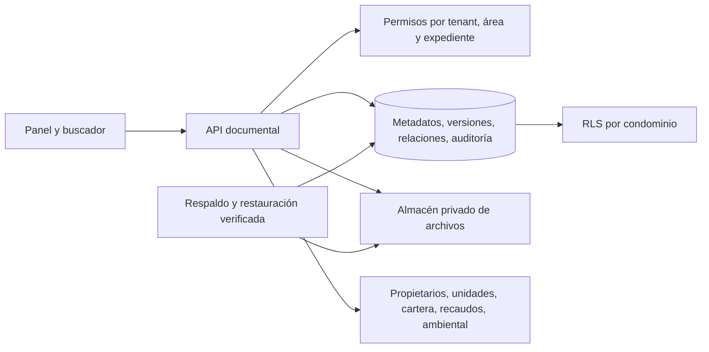

# Diseño técnico REQ-006 (borrador)

## Arquitectura propuesta

React/Vite presenta el panel documental, buscador y expediente. NestJS proporciona la API bajo `/api/v1/documentos`; Prisma/PostgreSQL conserva metadatos, relaciones, versiones, ACL y auditoría. Los archivos se guardan en un volumen privado persistente del servidor (25 MB por archivo) y se sirven solo mediante API autenticada. El script `deploy/backup-zulu.sh` respalda DB y binarios; la frecuencia programada y prueba de restauración quedan para el servidor.

## Modelo funcional

- `ExpedienteDigital`: pertenece a un condominio y área; incluye nombre, asunto, responsable, confidencialidad, estado y fechas.
- `DocumentoDigital`: identidad documental, tipo, origen, radicado, fecha documental, hash y estado de revisión.
- `VersionDocumento`: registro inmutable por archivo/version; la nueva versión no sustituye ni borra bytes anteriores.
- `RelacionDocumento`: relaciones tipadas a propietario, unidad, proceso ambiental, recaudo, cartera o cuenta existentes. Referencias a módulos ausentes no se presentan como registros válidos.
- `ActuacionDocumental`: cronología con fecha documental y fecha de recepción separadas.
- ACL reutiliza la matriz de roles existente, restricciones/concesiones por expediente y compartición explícita por usuario para Consejo y casos confidenciales.
- Relaciones tipadas validadas con propietarios, unidades, obligaciones de cartera, recaudos, cuentas de cobro y procesos ambientales existentes.
- Los documentos legados permanecen en sus módulos fuente; su incorporación se hará después, como pidió el usuario.

## Seguridad y búsqueda

- Toda consulta usa `PrismaService.withTenant`; tablas nuevas con RLS y claves/relaciones que contienen `condominio_id`.
- La búsqueda filtra ACL antes de responder y usa las mismas comprobaciones que descarga/exportación. No revelar título, coincidencia ni existencia de un documento restringido.
- Búsqueda sobre nombre, asunto, radicado, etiquetas, entidades relacionadas y texto extraído en PDF, DOCX y XLS/XLSX. La búsqueda de imágenes escaneadas requiere OCR y se propone para fase posterior.
- Registrar carga, nueva versión, consulta sensible, descarga, exportación y cambios de permisos en auditoría.
- Validar extensión/MIME, firma del archivo, tamaño, nombre seguro y checksum. Ninguna URL pública.

## Respaldo y conservación

El script de respaldo cubre metadatos y binarios, valida ambos archivos y genera SHA-256. La frecuencia programada y prueba de restauración en servidor están pendientes. Los binarios legados siguen en sus módulos de origen.

## Supuestos temporales

- No se importan documentos existentes hasta que el usuario indique la fuente y confirme volumen/autoridad.
- Los estados extraídos o fechas sugeridas quedan como pendientes de revisión; no crean automáticamente obligaciones ni vencimientos.
- OCR no se incluye en primera fase por indicación del usuario.
