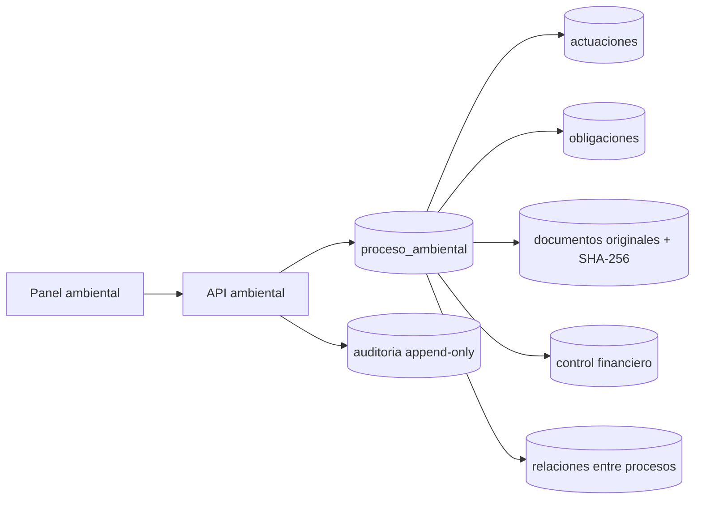

# Diseño técnico REQ-007

## Arquitectura

React/Vite presenta seis fichas y un detalle seleccionado. NestJS expone la API bajo `/api/v1/ambiental`; toda lectura y escritura pasa por `PrismaService.withTenant`. PostgreSQL mantiene RLS en cada tabla nueva.

## Decisiones

- Proceso, actuación, obligación, documento, relación entre procesos, vínculo secundario de documentos y movimiento financiero son tablas separadas. Cada documento conserva un expediente principal y un único original; los vínculos no copian ni sincronizan estados.
- `fecha_vencimiento_validada` solo genera alertas cuando `vencimiento_verificado` es verdadero, y esa validación requiere fecha de notificación verificada y plazo registrado.
- Actuaciones, documentos y registros financieros se insertan sin permiso de actualización/borrado. Las correcciones financieras se registran como un nuevo ajuste.
- Los cambios de estado jurídico/técnico usan permiso `aprobar`. Aprobación, prórroga concedida y cierre requieren al menos un documento validado en el expediente.
- Los documentos conservan bytes originales, MIME, nombre, tamaño y SHA-256; el acceso requiere permiso del área 06.
- El crédito inicial de CVC se muestra pendiente de conciliación, aislado de cartera/tesorería.
- Las seis fichas se inicializan al primer acceso; los antecedentes de REQ-007 se guardan como pendiente de verificación.

## Permisos

Área `06` Ambiental y agua. Lectura, creación, edición y exportación se evalúan con `RequierePermiso`, además de autenticación, MFA cuando aplique y contexto de copropiedad.

## RLS

Las seis tablas usan `condominio_id = app_condominio_id()` tanto en `USING` como en `WITH CHECK`. Las relaciones compuestas incluyen `condominio_id` para impedir enlaces entre tenants.
